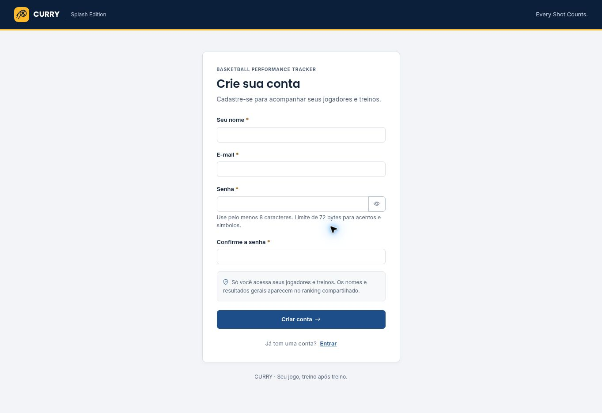

# CURRY — Splash Edition 🏀

**Every Shot Counts.** Plataforma para jogadores amadores acompanharem o arremesso de três pontos. Registre sessões e resultados nas cinco zonas da quadra, consulte a evolução e compare atletas. A interface usa uma identidade esportiva original.



## Executar com Docker

Requer Docker com Compose. No PowerShell, dentro da pasta do projeto:

```powershell
Copy-Item .env.example .env
notepad .env
```

Defina `DB_PASSWORD` no arquivo `.env` e execute:

```powershell
docker compose up --build -d
docker compose logs -f app
```

Abra [http://localhost:8080](http://localhost:8080) quando a aplicação iniciar. O pacote serve o Angular e a API na mesma origem. O PostgreSQL usa o volume `curry_pgdata`, que conserva os registros após reiniciar os serviços. Para parar, use `docker compose down`.

O banco começa vazio. Abra **Criar minha conta**, informe nome, e-mail e senha, entre e cadastre seu jogador. Cada conta vê somente seus próprios jogadores, treinos e arremessos. O ranking é compartilhado entre as contas autenticadas e mostra somente os nomes e resultados gerais.

Para carregar a demonstração na sua conta, substitua `EMAIL_DA_CONTA` pelo e-mail que você cadastrou:

```powershell
docker compose cp database/demo.sql db:/tmp/curry-demo.sql
docker compose exec -T db psql -U curry -d curry -v usuario_email=EMAIL_DA_CONTA -v ON_ERROR_STOP=1 -f /tmp/curry-demo.sql
```

O script cadastra três atletas e treinos em datas diferentes para a conta informada. A carga é manual e uma segunda execução para a mesma conta não duplica os perfis existentes. Nenhuma senha demonstrativa ou conta padrão é criada.

## Executar em desenvolvimento

Requer JDK 21, Maven 3.9, Node.js 24.15 ou superior da linha 24 e PostgreSQL. Crie o banco `curry` e um usuário com permissão para construir o esquema, ou inicie somente o banco com `docker compose up -d db` usando a configuração anterior.

Em um terminal PowerShell, configure e execute a API:

```powershell
$env:DB_URL = 'jdbc:postgresql://127.0.0.1:5432/curry'
$env:DB_USER = 'curry'
$env:DB_PASSWORD = Read-Host 'Senha do PostgreSQL'
mvn -f backend/pom.xml spring-boot:run
```

Em outro terminal, execute o Angular:

```powershell
cd frontend
npm ci
npm start
```

Abra [http://localhost:4200](http://localhost:4200). O Angular CLI encaminha `/api` para a porta 8080. Se usar outra porta para o backend, ajuste o destino no arquivo `frontend/proxy.conf.json`. Em Bash, use `export NOME=valor` para configurar as variáveis de ambiente.

| Variável | Uso | Padrão |
| --- | --- | --- |
| `DB_URL` | URL JDBC do PostgreSQL | `jdbc:postgresql://127.0.0.1:5432/curry` |
| `DB_USER` | Usuário do banco | `curry` |
| `DB_PASSWORD` | Senha do banco | Configurada no ambiente |
| `SERVER_ADDRESS` | Endereço em que a API escuta | `127.0.0.1` |
| `SERVER_PORT` | Porta da API | `8080` |
| `SESSION_COOKIE_SECURE` | Cookie de sessão somente por HTTPS em hospedagem | `false` local, `true` automático no Codespaces via Compose |
| `CORS_ORIGINS` | Origens da API, separadas por vírgula | `http://localhost:4200,http://127.0.0.1:4200` |

### Registros existentes antes do login

A migração `V3__contas_e_propriedade.sql` adiciona `usuarios` e o proprietário de cada jogador, sem apagar os registros. Jogadores antigos ficam com `usuario_id IS NULL`, invisíveis na API e no ranking, até uma vinculação feita pelo operador do banco. Nenhuma pessoa que se cadastrar pode reivindicar esses dados pela interface.

Depois de criar sua conta, o dono do banco pode vincular os jogadores antigos, preservando seus treinos e arremessos:

```powershell
docker compose cp database/vincular-legado.sql db:/tmp/curry-vincular.sql
docker compose exec -T db psql -U curry -d curry -v usuario_email=EMAIL_DA_CONTA -v ON_ERROR_STOP=1 -f /tmp/curry-vincular.sql
```

Este comando vincula **todos os jogadores que ainda não têm dono** à conta explicitamente informada. Ele não muda jogadores já pertencentes a outra conta. Revise os registros antigos antes de executá-lo se o banco tiver sido compartilhado por várias pessoas.

### Conectar ao Neon

No painel do Neon, copie o host da conexão direta, o banco e o nome do usuário. Configure o backend com TLS e uma função autorizada a criar tabelas e views. O Flyway aplica o esquema quando a API inicia. [Guia JDBC do Neon](https://neon.com/docs/guides/java)

```powershell
$env:DB_URL = 'jdbc:postgresql://HOST_DIRETO:5432/BANCO?sslmode=require'
$env:DB_USER = 'USUARIO_DO_NEON'
$env:DB_PASSWORD = Read-Host 'Senha do Neon'
mvn -f backend/pom.xml spring-boot:run
```

#### Usar o Neon pelo Docker no Codespace

Com o banco importado no Neon, execute no terminal Bash da pasta do projeto:

```bash
bash scripts/iniciar-neon.sh
```

O comando solicita a URL JDBC da conexão direta, sem credenciais, e depois a senha, com a digitação oculta. Use o formato de URL da seção anterior. O usuário padrão é `neondb_owner`; informe `NEON_DB_USER` no ambiente se sua conta usar outro nome. A senha é enviada ao ambiente do contêiner e não é escrita no repositório. Como em qualquer contêiner, um administrador do Docker consegue inspecionar suas variáveis.

O script usa `compose.neon.yml`, que executa somente o serviço `app`. A aplicação passa a usar o Neon; o serviço `db` e o volume local existentes são preservados. Para acompanhar o início do Java:

```bash
docker compose -f compose.neon.yml logs -f app
```

Espere a mensagem `Started CurryApplication` e abra a porta 8080 encaminhada pelo Codespace. Cadastre um registro de teste pela interface e consulte-o no SQL Editor do Neon para confirmar a integração. As consultas do SQL Editor são administrativas; as telas do CURRY continuam respeitando o proprietário da conta.

Para parar apenas a aplicação conectada ao Neon:

```bash
docker compose -f compose.neon.yml stop app
```

Para voltar a usar o banco local, com a configuração original de `.env`, execute `docker compose up -d app`. O Codespace precisa permanecer ativo para executar o Java. Este modo permite demonstrar o sistema com Neon sem contratar o Render; hospedar o frontend na Vercel não mantém o Java em execução.

## Arquitetura e estrutura

O Angular 22 usa componentes standalone, Router, Reactive Forms, HttpClient, Bootstrap 5, Bootstrap Icons e Chart.js. A área de trabalho clara usa tabelas, formulários e controles do Bootstrap. O azul-marinho e o dourado identificam a navegação. As fontes Poppins e Inter são servidas pela aplicação. O Spring Boot 3.5 usa Java 21, Spring Web, Spring Data JPA, Hibernate, Bean Validation, Flyway e Spring Security. Os CRUDs usam JPA e os relatórios consultam views PostgreSQL por SQL parametrizado.

```text
curry-splash-edition/
├── backend/
│   ├── pom.xml
│   └── src/
│       ├── main/java/br/com/curry/
│       │   ├── config/       # Spring Security, CORS e rotas da SPA
│       │   ├── controller/   # contratos HTTP
│       │   ├── dto/          # entradas e respostas validadas
│       │   ├── entity/       # mapeamento JPA
│       │   ├── exception/    # erros padronizados
│       │   ├── repository/   # JPA e consultas SQL
│       │   ├── security/     # conta autenticada e identificação do proprietário
│       │   └── service/      # regras e transações
│       ├── main/resources/db/migration/
│       └── test/java/br/com/curry/
├── frontend/
│   ├── public/              # identidade visual do CURRY
│   ├── src/app/             # core, layout, shared e features
│   └── e2e/                 # testes Playwright
├── database/               # demonstração e vinculação dos registros antigos
├── queries.sql
├── compose.yml
├── Dockerfile
├── .env.example
├── CHECKLIST.md
└── README.md
```

### Modelo de dados

| Tabela | PK | FK | Conteúdo |
| --- | --- | --- | --- |
| `usuarios` | `id` | | Nome, e-mail único normalizado, hash BCrypt e data de cadastro |
| `jogadores` | `id` | `usuario_id → usuarios.id` | Nome, apelido, posição e data de cadastro automática |
| `treinos` | `id` | `jogador_id → jogadores.id` | Data, duração, observações e data de cadastro |
| `arremessos` | `id` | `treino_id → treinos.id` | Zona, tentativas e acertos |

Os relacionamentos são 1:N: `usuarios → jogadores → treinos → arremessos`. A FK da conta usa `ON DELETE RESTRICT`; as FKs de treinos e arremessos usam `ON DELETE CASCADE`. `usuario_id` aceita NULL somente para preservar registros anteriores à autenticação; todo novo jogador criado pela API recebe a conta autenticada. Há uma zona por treino, garantida por `UNIQUE (treino_id, zona)`. As restrições `CHECK` validam zona, duração positiva e a regra `0 ≤ acertos ≤ tentativas`. Os índices atendem à busca por jogador, data e treino.

### Funcionalidades e cálculos

- **Contas** com cadastro por nome, e-mail e senha, login, restauração da sessão ao recarregar e logout. Todos os recursos individuais pertencem à conta autenticada.
- **Dashboard** com os últimos treinos em primeiro plano, totais do jogador ativo, gráfico de evolução, quadra interativa e tabela de aproveitamento por zona. A seleção é limpa ao sair da conta.
- **Jogadores e treinos** com cadastro, listagem, detalhe, edição e exclusão com confirmação.
- **Arremessos** com edição e consulta por zona. Na tela do treino, clicar na quadra muda a zona de entrada. A sessão e os resultados preenchidos são gravados na mesma transação.
- **Evolução** com série por data, melhor sessão, variação em pontos percentuais, duas sessões comparáveis e histórico cronológico.
- **Ranking** com taxa de acerto, quantidade de tentativas, acertos, treinos e melhor zona. Jogadores sem tentativas aparecem sem colocação. Empates compartilham a colocação.
- **Taxa de acerto** é `100 × SUM(acertos) / SUM(tentativas)`. Sessões na mesma data entram na mesma soma do gráfico. Com zero tentativas, a API devolve `null` e a interface exibe um traço. A melhor zona utiliza a taxa e, no empate, favorece o volume de tentativas.
- **Quadra** com pontos acionáveis por toque, mouse ou teclado. A cor acompanha o valor textual. Cinza indica ausência de tentativas, lilás indica taxa abaixo de 35%, verde-água indica taxa entre 35% e 50% e dourado começa em 50%.

## Autenticação e privacidade

- A senha é armazenada como hash BCrypt com custo 12. O e-mail é normalizado para minúsculas e possui UNIQUE no PostgreSQL. A senha exige ao menos 8 caracteres e no máximo 72 bytes UTF-8.
- O Spring Security mantém a sessão no servidor. O cookie `JSESSIONID` é HttpOnly, SameSite=Lax e Secure quando configurado para HTTPS. O identificador é trocado no login e invalidado no logout. A sessão expira após 30 minutos de inatividade. Reiniciar o backend encerra as sessões, preservando contas e dados no PostgreSQL.
- O Angular não grava senha nem token de autenticação no localStorage. Solicita um token CSRF em `/api/auth/csrf` e o envia no cabeçalho `X-CSRF-TOKEN` em POST, PUT e DELETE, incluindo cadastro, login e logout. O token fica em memória e é renovado após mudar a sessão.
- Todas as consultas e alterações de jogadores, treinos, arremessos e estatísticas individuais conferem o dono no backend. IDs pertencentes a outra conta respondem 404. Filtros de listagem também são restritos à conta. A interface usa guards e limpa os dados ao sair.
- O ranking requer login e compartilha apenas nome/apelido/posição e estatísticas agregadas. Não oferece navegação para perfis de terceiros nem expõe e-mail, senha, datas dos treinos ou observações.
- Para HTTPS fora do Codespaces, configure `SESSION_COOKIE_SECURE=true` e as origens exatas permitidas. Mantenha Angular e API na mesma origem para simplificar a sessão.

## API REST

| Método | Caminho | Operação |
| --- | --- | --- |
| GET | `/api/auth/csrf` | Obter token CSRF, inclusive antes de entrar |
| POST | `/api/auth/cadastro` | Criar conta: `nome`, `email`, `senha` |
| POST | `/api/auth/login` | Entrar: `email`, `senha`; retorna conta sem a senha |
| GET | `/api/auth/me` | Consultar a conta autenticada |
| POST | `/api/auth/logout` | Encerrar a sessão, resposta 204 |

As rotas abaixo exigem uma sessão autenticada. Os POST/PUT/DELETE também exigem CSRF. A API não recebe o proprietário do jogador pelo formulário: ela o identifica pela sessão.

| Método | Caminho | Operação |
| --- | --- | --- |
| GET, POST | `/api/jogadores` | Listar ou cadastrar |
| GET, PUT, DELETE | `/api/jogadores/{id}` | Consultar, editar ou excluir |
| GET, POST | `/api/treinos` | Listar ou cadastrar. GET aceita `jogadorId` |
| GET, PUT, DELETE | `/api/treinos/{id}` | Detalhar, editar ou excluir |
| GET, POST | `/api/arremessos` | Listar ou cadastrar. GET aceita `treinoId` e `jogadorId` |
| GET, PUT, DELETE | `/api/arremessos/{id}` | Consultar, editar ou excluir |
| GET | `/api/estatisticas/jogadores/{id}/resumo` | Totais, melhor zona e últimos cinco treinos |
| GET | `/api/estatisticas/jogadores/{id}/zonas` | Totais das cinco zonas |
| GET | `/api/estatisticas/jogadores/{id}/evolucao` | Pontos por data, sessões e melhor treino |
| GET | `/api/estatisticas/ranking` | Comparação entre jogadores |

Os POST dos CRUDs respondem com `201 Created` e cabeçalho `Location`. DELETE responde com `204 No Content`. Os erros incluem `400` para dados inválidos, `401` sem sessão ou com credenciais incorretas, `403` para token CSRF inválido, `404` para registro inexistente e `409` para conflito. Requisições usam JSON com data no formato `AAAA-MM-DD`.

Exemplo de corpo para cadastrar um treino com um registro por zona em `POST /api/treinos`. Use o ID de um jogador da sua conta.

```json
{
  "jogadorId": 1,
  "data": "2026-11-16",
  "duracaoMinutos": 45,
  "observacoes": "Trabalhei a finalização após o drible.",
  "arremessos": [
    { "zona": "TOPO_DO_ARCO", "tentativas": 20, "acertos": 11 }
  ]
}
```

Em `PUT /api/treinos/{id}`, omita `arremessos` para manter as zonas atuais, ou envie a lista completa para substituí-las. `[]` limpa o treino. Para gravar uma zona individual em `/api/arremessos`, envie `treinoId`, `zona`, `tentativas` e `acertos`. Em um PUT individual, use o `treinoId` original.

## SQL para apresentar

As consultas SQL são executadas pelo operador do banco e podem mostrar registros de todas as contas. Elas não são endpoints públicos. Nunca compartilhe credenciais do PostgreSQL no frontend.

O arquivo [queries.sql](queries.sql) inclui o JOIN entre as tabelas, COUNT, SUM, percentuais protegidos por NULLIF, agrupamento por zona e por data e uma subconsulta correlacionada. As views usadas pela API estão na [migração de estatísticas](backend/src/main/resources/db/migration/V2__consultas_estatisticas.sql).

```powershell
docker compose cp queries.sql db:/tmp/curry-queries.sql
docker compose exec -T db psql -U curry -d curry -v ON_ERROR_STOP=1 -f /tmp/curry-queries.sql
```

## Testes

Para verificar a atualização de um banco V2 com um jogador, treino e arremessos antigos, a vinculação a uma conta, a carga demonstrativa executada duas vezes e as seis consultas SQL, use:

```bash
bash scripts/verificar-sql.sh
```

O roteiro usa um esquema PostgreSQL descartável no serviço `db` do Compose e o remove ao terminar. Não altera o esquema da aplicação.

Os testes do backend usam um banco PostgreSQL de teste. Informe uma URL JDBC, um usuário com permissão de criação de esquemas e a senha local, se aplicável. A suíte cria e remove um esquema próprio. Sem a URL, os testes de integração são ignorados.

```powershell
$env:CURRY_TEST_DB_URL = 'jdbc:postgresql://127.0.0.1:5432/curry_test'
$env:CURRY_TEST_DB_USER = 'curry'
$env:CURRY_TEST_DB_PASSWORD = Read-Host 'Senha do banco de teste'
mvn -f backend/pom.xml verify
```

Para verificar o pacote completo com o PostgreSQL do Compose em um **esquema descartável**, use Bash com Docker, Node e Python disponíveis:

```bash
docker compose up -d db
docker compose build app
bash scripts/testar-e2e.sh
```

O executor usa a imagem recém-compilada em `127.0.0.1:18080`, configura um esquema exclusivo para os testes e o remove ao terminar. Ele não altera jogadores ou contas do esquema da aplicação. Os relatórios ficam em `frontend/test-results/` quando há falha. O Chromium precisa das bibliotecas do sistema; se necessário, use `npx playwright install --with-deps chromium` dentro de `frontend`.

Para executar manualmente contra uma aplicação de teste já configurada:

```powershell
cd frontend
npm ci
npm run build
npx playwright install chromium
npm run test:e2e
```

O Playwright usa a URL `http://127.0.0.1:8080` por padrão. Para testar o Angular em modo de desenvolvimento, defina `CURRY_E2E_BASE_URL=http://127.0.0.1:4200` no ambiente. A suíte cadastra contas com credenciais aleatórias, exercita login/logout e cria jogadores de teste. Execute-a em um banco ou esquema descartável, pois não há endpoint para excluir contas. Ela também usa duas sessões independentes para verificar que os dados privados não aparecem na outra conta e que o ranking exibe somente os resultados gerais.

### Verificações executadas

- Build de produção Angular concluído e imagem Docker com Angular + Spring Boot compilada no Codespaces.
- **8 testes de integração aprovados com PostgreSQL 17.12**: CRUD, validação, restrições e cascata, percentuais ponderados, cadastro, hash BCrypt, e-mail único, rotação da sessão, CSRF e logout.
- O teste com duas contas cobriu listas e filtros, leitura/edição/exclusão por IDs de terceiros, reassociação de treinos e arremessos e estatísticas privadas. O ranking compartilhou os nomes e totais sem e-mail, senha ou observações. Registros legados sem dono ficaram inacessíveis.
- **3 testes Playwright aprovados no pacote integrado**: cadastro/login, os três CRUDs com as cinco zonas e atualização do gráfico, navegação e quadra em 390 px, privacidade entre duas sessões, ranking sem links de terceiros, restauração ao recarregar e logout seguido de retorno pelo histórico.
- `scripts/verificar-sql.sh` aprovado: atualização V2 → V3 com registros existentes, vinculação do legado, duas cargas demonstrativas sem duplicação (4 jogadores, 16 treinos e 76 zonas incluindo o legado) e as seis consultas do `queries.sql`.
- Os testes de integração, de navegador e de SQL usaram esquemas descartáveis. O esquema e os dados da aplicação em execução foram preservados.

## Limitações

Esta versão acadêmica tem cadastro, autenticação e isolamento por proprietário. Não inclui confirmação de e-mail, recuperação de senha, MFA, moderação do ranking ou limitação de tentativas de login. Uma publicação aberta exige configurar esses controles operacionais, HTTPS, backups e monitoramento. A sessão fica na memória de uma instância do backend; uma hospedagem com várias instâncias precisaria compartilhar as sessões. A conexão Neon exige suas credenciais. Os dados antigos precisam ser vinculados pelo operador conforme a seção de migração.

Consulte o [CHECKLIST.md](CHECKLIST.md) para a apresentação acadêmica.
